  

<b>B.Tech CSE @ VGU Jaipur</b> &nbsp;·&nbsp; <a href="https://piyushanand.me"><b>piyushanand.me</b></a>

  
  
  
  

### About Me

- **B.Tech CSE** @ Vivekananda Global University, Jaipur — *Class of 2028*
- **Co-Founder & CTO** @ **SafeSphere Technologies** — a DPIIT-recognized startup building safety & emergency response technology
- Building **AURA** — an AI-driven disaster relief pipeline using BERT-based NLP, NER, and urgency scoring
- Deep interest in **Cybersecurity**, backend systems, and secure application design
- Currently exploring **agent-first software development**, **MCP (Model Context Protocol)** tooling, and applied **ML/NLP**
- Learning **Japanese**
- I ship solo — founder, architect, and developer, all in one

### Tech Stack

**Languages & Core**

**Backend & Infra**

**AI / ML**

**Tools**

### Featured Projects

| Project | Description |
|---|---|
| **[AURA](https://project-aura-phi.vercel.app/)** | AI-driven universal disaster response pipeline — BERT classification, NER, geocoding, urgency scoring, and a live MongoDB + Flask dashboard |
| **[SignEd](#)** | Dockerized document-signing platform with OTP email auth, JWT sessions, and a full REST API |
| **[Barsa Enterprises](https://barsa.co.in)** | Brand & web presence for a woodworks and laser-engraving business |

### GitHub Stats

  

### Connect With Me

<i>Building safety tech, one commit at a time.</i>

